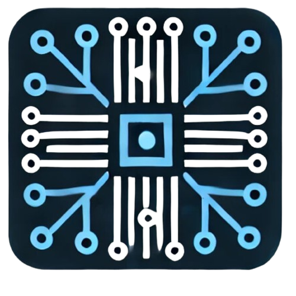
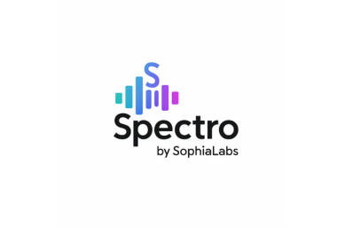
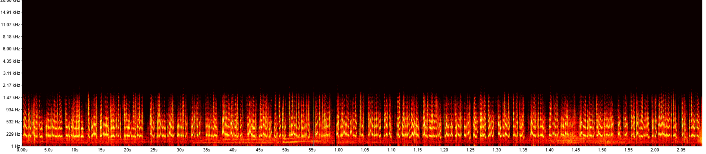
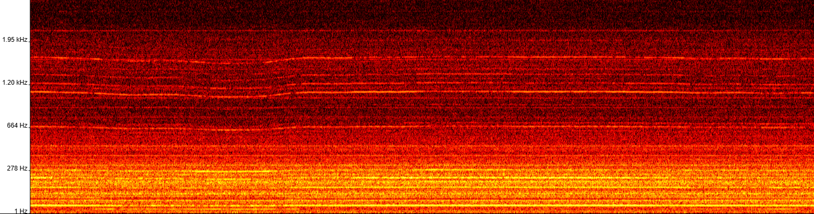
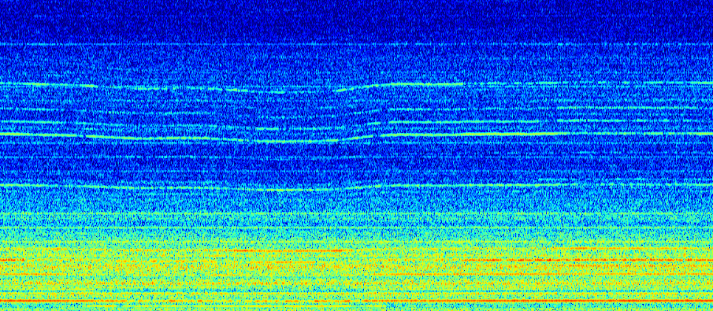

<h1>
   Spectro
</h1>




## Introdução

**Spectro** é uma biblioteca TypeScript para gerar **espectrogramas** a partir de dados de áudio (Float32Array).  
Ela usa FFT com várias funções janela, possui **escala Linear e Mel**, colormaps inspirados no Matplotlib, **filtros FIR** (passa-baixa, passa-alta, passa-banda, rejeita-banda), **eixo de frequência e eixo de tempo opcionais**, **hop size configurável**, exportação **PNG em alta resolução**, além de **detecção de pitch** e **extração de harmônicos**.







## Recursos

- Geração de espectrograma a partir de **single channel Float32Array**
- Parâmetros flexíveis:
  - Taxa de amostragem, faixa de frequência (**fMin**, **fMax**)
  - Tamanho de FFT, **hop size** configurável e funções janela (`None`, `Cosine`, `Hanning`, `BH7`)
  - **Escala Linear** ou **Mel (remapeamento real na exibição)**
  - Colormaps customizáveis
  - **Eixo de frequência** e **eixo de tempo** opcionais (com ticks dinâmicos)
  - Altura/largura finais do canvas (com margens dinâmicas quando eixos estão habilitados)
  - **Ganho (gainDb)** e **normalização por faixa (rangeDb)** ancorada no pico global
- **Exportação PNG em alta resolução** (upscale configurável)
- **Filtros** FIR de pré-processamento: **lowpass**, **highpass**, **bandpass**, **notch**
- **Pitch Tracking** (autocorrelação) e **extração de harmônicos**
- Colormaps exportados e tipados (ex.: `hot`, `jet`, `viridis`, …)


## Pré-requisitos

Antes de começar, certifique-se de ter as seguintes ferramentas instaladas:

- [Node.js](https://nodejs.org/) (recomendado versão LTS)
- npm (geralmente vem com o Node.js)

## Instalação

Siga as etapas abaixo para configurar o projeto em sua máquina local:

1. Clone o repositório:
    ```bash
    git clone https://github.com/IMNascimento/Spectro.git
    ```
2. Navegue até o diretório do projeto:
    ```bash
    cd Spectro
    ```
3. Instale as dependências:
    ```bash
    npm install
    ```

## Configuração do TypeScript:
O arquivo tsconfig.json já está configurado para gerar módulos ES6 e arquivos de declaração (d.ts):
```json
{
    "compilerOptions": {
        "target": "ES5",
        "module": "ES6",
        "declaration": true,
        "outDir": "./dist",
        "strict": true,
        "esModuleInterop": true,
        "lib": ["dom", "es2015"]
    },
    "include": ["src/**/*"]
}
```

## Compilação
Para compilar o código TypeScript e gerar os arquivos JavaScript na pasta dist, execute:
```bash
    npm run build
```

## API (Visão Geral)

### `SpectrogramParams`

| Parâmetro | Tipo | Padrão | Descrição |
|---|---|---:|---|
| `sampleRate` | `number` | `44100` | Taxa de amostragem (Hz). |
| `scaleType` | `'Linear' \| 'Mel'` | `'Linear'` | Escala vertical. Em **Mel**, a exibição remapeia a altura do espectrograma para a escala perceptual. |
| `fMin` | `number` | `1` | Frequência mínima (Hz). |
| `fMax` | `number` | `30000` | Frequência máxima (Hz). |
| `fftSize` | `number` | `2048` | Tamanho da FFT (potência de 2). |
| `hopSize` | `number` | `fftSize/2` | Passo entre frames em amostras. |
| `windowType` | `'None' \| 'Cosine' \| 'Hanning' \| 'BH7'` | `'BH7'` | Função janela. |
| `colormapName` | `string` | `'hot'` | Nome do colormap (precisa existir no `window`). |
| `canvasHeight` | `number` | `500` | Altura do espectrograma (área útil). |
| `targetWidth` | `number` | `0` | Largura final desejada; `0` usa `window.innerWidth`. |
| `nTicks` | `number` | `0` | Nº de ticks de frequência (0 = cálculo dinâmico). |
| `gainDb` | `number` | `0` | Ganho em dB aplicado ao espectro. |
| `rangeDb` | `number` | `80` | Faixa em dB p/ normalização **ancorada no pico global**. Se `0`, usa fallback seguro `80`. |
| `showFrequencyAxis` | `boolean` | `false` | Exibe eixo de frequência (adiciona margens laterais). |
| `showTimeAxis` | `boolean` | `false` | Exibe eixo de **tempo** (adiciona margem inferior). |
| `timeTickMinPx` | `number` | `60` | Espaçamento mínimo entre ticks do eixo de tempo (px). |
| `filterType` | `'none' \| 'lowpass' \| 'highpass' \| 'bandpass' \| 'notch'` | `'none'` | Tipo de filtro FIR aplicado antes da FFT. |
| `filterCutoffs` | `number[]` | `[]` | Para `lowpass/highpass`: `[cutoff]`. Para `bandpass/notch`: `[lowCut, highCut]`. |
| `enablePitchDetection` | `boolean` | `false` | Habilita detecção de frequência fundamental (autocorrelação). |
| `enableHarmonicsExtraction` | `boolean` | `false` | Habilita extração de harmônicos (múltiplos inteiros da fundamental). |

### Métodos principais

- `generateSpectrogram(audioData: Float32Array): HTMLCanvasElement`  
  Gera e retorna um `<canvas>` com o espectrograma.  
  **Obs.:**  
  - Se `showFrequencyAxis` for `true`, são aplicadas margens laterais (60px esquerda, 10px direita).  
  - Se `showTimeAxis` for `true`, é aplicada margem inferior (~22px) para os rótulos.  

- `exportHighResPNG(audioData: Float32Array, upscale = 2): string`  
  Renderiza o espectrograma e retorna um **DataURL PNG** em alta resolução (`upscale` = fator de ampliação).

- `detectPitch(audioData: Float32Array): number`  
  Retorna a **frequência fundamental (Hz)** usando autocorrelação simples (útil para *pitch tracking* básico).

- `extractHarmonics(audioData: Float32Array): { fundamental: number; harmonics: number[] }`  
  Calcula a fundamental e retorna os **harmônicos** (múltiplos inteiros), respeitando `fMax`.

---

## Colormaps (como disponibilizar)

A lib espera funções de colormap no **escopo global** (`window`). Use o helper `partial` para expor:

```ts
import { partial } from '@sophialabs/spectro';

(window as any).partial = partial;
(window as any).hot = partial('hot');
(window as any).jet = partial('jet');
(window as any).viridis = partial('viridis');
(window as any).Greens = partial('Greens');
(window as any).turbo = partial('turbo');
(window as any).terrain = partial('terrain');
(window as any).RdPu = partial('RdPu');
(window as any).binary = partial('binary');
```

---


## Exemplos de Uso

### Em Angular
1. Instale sua lib via npm.
```bash
npm i @sophialabs/spectro
```
2. Importe a classe em um componente Angular:
```ts
// app.component.ts
import { Component } from '@angular/core';
import { SpectrogramGenerator, SpectrogramParams, partial } from '@sophialabs/spectro';

@Component({
  selector: 'app-root',
  template: `
    <input type="file" (change)="onFileChange($event)" accept="audio/*" />
    <div id="container"></div>
  `,
  styles: [`
    #container canvas {
      border: 1px solid #000;
      display: block;
      margin: 10px auto;
    }
  `]
})
export class AppComponent {
  onFileChange(event: Event) {
    const input = event.target as HTMLInputElement;
    if (input.files && input.files.length) {
      const file = input.files[0];
      const reader = new FileReader();
      reader.onload = async (e: any) => {
        const arrayBuffer = e.target.result;
        const audioCtx = new AudioContext();
        const audioBuffer = await audioCtx.decodeAudioData(arrayBuffer);
        const audioData = audioBuffer.getChannelData(0);

        // Exponha os colormaps globalmente para que a lib os encontre:
        (window as any).partial = partial;
        (window as any).hot = partial('hot');
        (window as any).jet = partial('jet');
        (window as any).viridis = partial('viridis');
        (window as any).Greens = partial('Greens');
        (window as any).turbo = partial('turbo');
        (window as any).terrain = partial('terrain');
        (window as any).RdPu = partial('RdPu');
        (window as any).binary = partial('binary');

        // Defina os parâmetros completos com valores e comentários explicativos:
        const params: SpectrogramParams = {
          sampleRate: 44100,         // Taxa de amostragem em Hz.
          scaleType: 'Mel',          // Escala de frequência ('Mel' ou 'Linear').
          fMin: 1,                   // Frequência mínima (Hz).
          fMax: 20000,               // Frequência máxima (Hz).
          fftSize: 2048,             // Tamanho do buffer FFT (deve ser potência de 2).
          windowType: 'BH7',         // Função janela: 'None', 'Cosine', 'Hanning' ou 'BH7'.
          colormapName: 'hot',       // Nome do colormap para renderização.
          canvasHeight: 500,         // Altura do canvas final (px).
          nTicks: 20,                // Número de ticks para o eixo de frequência (0 para cálculo automático).
          gainDb: 20,                // Ganho em dB (0 para sem alteração).
          rangeDb: 80,               // Intervalo em dB para normalização (0 para manter escala original).
          targetWidth: 0,            // Largura final desejada (0 utiliza window.innerWidth).
          showFrequencyAxis: false,  // Define se o eixo de frequência será exibido.
          filterType: 'none',        // Tipo de filtro: 'none', 'lowpass', 'highpass', 'bandpass' ou 'notch'.
          filterCutoffs: [],         // Frequências de corte para o filtro (ex: [cutoff] para lowpass).
          enablePitchDetection: true,    // Se true, habilita a detecção de pitch (calcula a frequência fundamental).
          enableHarmonicsExtraction: true  // Se true, habilita a extração de harmônicos (baseada na fundamental).
        };

        // Cria a instância do gerador com os parâmetros definidos:
        const generator = new SpectrogramGenerator(params);

        // Gera o espectrograma e insere o canvas no DOM:
        const canvas = generator.generateSpectrogram(audioData);
        document.querySelector('#container')?.appendChild(canvas);

        // Se a flag de detecção de pitch estiver habilitada, chama o método detectPitch():
        if (params.enablePitchDetection) {
          const fundamentalFreq = generator.detectPitch(audioData);
          console.log('Frequência Fundamental detectada:', fundamentalFreq, 'Hz');
        } else {
          console.log('Detecção de Pitch desabilitada.');
        }

        // Se a flag de extração de harmônicos estiver habilitada, chama o método extractHarmonics():
        if (params.enableHarmonicsExtraction) {
          const { fundamental, harmonics } = generator.extractHarmonics(audioData);
          console.log('Frequência Fundamental:', fundamental, 'Hz');
          console.log('Harmônicos extraídos:', harmonics);
        } else {
          console.log('Extração de Harmônicos desabilitada.');
        }
      };
      reader.readAsArrayBuffer(file);
    }
  }
}
```

3. Adicione os assets necessários:
Certifique-se de que os arquivos compilados (por exemplo, os arquivos de sua lib e os colormaps) estejam disponíveis no build final do Angular. Você pode incluí-los via assets ou importar diretamente em seus módulos.

### Em Outros Projetos TypeScript/JavaScript
Basta importar a lib normalmente, seja via npm ou via um caminho relativo. Por exemplo, em um projeto Node.js ou um script ES:
```ts
import { SpectrogramGenerator, SpectrogramParams, partial } from '@sophialabs/spectro';

// Exponha os colormaps globalmente, se necessário:
window.hot = partial('hot');
window.jet = partial('jet');
window.viridis = partial('viridis');
window.Greens = partial('Greens');
window.turbo = partial('turbo');
window.terrain = partial('terrain');
window.RdPu = partial('RdPu');
window.binary = partial('binary');

// Criação do objeto de parâmetros, com comentários sobre cada um:
const params: SpectrogramParams = {
  sampleRate: 44100,         // Taxa de amostragem em Hz
  scaleType: 'Mel',          // Tipo de escala ('Mel' ou 'Linear')
  fMin: 1,                   // Frequência mínima (Hz)
  fMax: 30000,               // Frequência máxima (Hz)
  fftSize: 2048,             // Tamanho do buffer FFT (deve ser potência de 2)
  windowType: 'BH7',         // Função janela: 'None', 'Cosine', 'Hanning' ou 'BH7'
  colormapName: 'hot',       // Nome do colormap usado para renderizar o espectrograma
  canvasHeight: 500,         // Altura do canvas final em pixels
  nTicks: 30,                // Número de ticks para o eixo de frequência (0 para cálculo automático)
  gainDb: 10,                // Ganho em dB aplicado aos dados (use 0 para manter sem alteração)
  rangeDb: 20,               // Intervalo em dB para normalização dos dados (0 para manter sem alteração)
  targetWidth: 0,            // Largura do canvas final (0 usa window.innerWidth)
  showFrequencyAxis: false,  // Se true, exibe o eixo de frequência no canvas
  filterType: 'none',        // Tipo de filtro: 'none', 'lowpass', 'highpass', 'bandpass' ou 'notch'
  filterCutoffs: [],         // Frequências de corte para o filtro (ex: [cutoff] para lowpass)
  enablePitchDetection: true,      // Habilita a detecção de pitch (retorna a frequência fundamental)
  enableHarmonicsExtraction: true    // Habilita a extração de harmônicos (calculados com base na fundamental)
};

// Suponha que audioData seja um Float32Array contendo os dados de áudio:
declare const audioData: Float32Array;

// Instancia a classe do gerador com os parâmetros definidos:
const generator = new SpectrogramGenerator(params);

// Gera o espectrograma e obtém o canvas resultante:
const canvas = generator.generateSpectrogram(audioData);
// Exemplo de uso: adicionar o canvas ao DOM:
document.body.appendChild(canvas);

// Se a detecção de pitch estiver habilitada, calcula a frequência fundamental:
if (params.enablePitchDetection) {
  const fundamentalFreq = generator.detectPitch(audioData);
  console.log('Frequência Fundamental detectada:', fundamentalFreq, 'Hz');
}

// Se a extração de harmônicos estiver habilitada, extrai os harmônicos:
if (params.enableHarmonicsExtraction) {
  const { fundamental, harmonics } = generator.extractHarmonics(audioData);
  console.log('Frequência Fundamental:', fundamental, 'Hz');
  console.log('Harmônicos extraídos:', harmonics);
}

// Opcional: Exporta uma imagem PNG de alta resolução do espectrograma (fator de ampliação = 3)
const pngDataUrl = generator.exportHighResPNG(audioData, 3);
console.log('PNG de alta resolução:', pngDataUrl);
```

### Testando a Biblioteca com um Áudio Local
Para testar a lib em uma página web:

1. Crie um arquivo index.html na raiz do projeto (ou utilize o exemplo fornecido abaixo).

2. Utilize um servidor local para servir os arquivos (por exemplo, com http-server). Se ainda não tiver o http-server instalado globalmente, instale-o via npm:
```bash
npm install -g http-server
```
3. Na raiz do projeto, execute:
```bash
http-server .
```
4. Acesse a URL fornecida (por exemplo, http://127.0.0.1:8080/) no navegador.

> **Importante:** não abra via `file://`. Sirva com um servidor local (ex.: `http-server .`).

## Exemplo de index.html
```html
<!DOCTYPE html>
<html lang="pt">
<head>
  <meta charset="UTF-8" />
  <title>Teste da Lib Spectro - Completo</title>
  <style>
    body { font-family: sans-serif; margin: 20px; }
    #controls { margin-bottom: 20px; }
    canvas { border: 1px solid #000; display: block; margin-top: 10px; max-width: 100%; }
    #spectroContainer { max-width: 100%; overflow-x: auto; }
    .param-group { margin-bottom: 10px; }
    label { display:block; margin-top: 5px; }
  </style>
</head>
<body>
  <h1>Teste da Lib Spectro - Completo</h1>

  <div id="controls">
    <div class="param-group">
      <label for="audioFile">Carregar arquivo de áudio:</label>
      <input type="file" id="audioFile" accept="audio/*">
    </div>

    <div class="param-group">
      <label>Escala:</label>
      <select id="scale">
        <option value="Linear">Linear</option>
        <option value="Mel" selected>Mel</option>
      </select>
    </div>

    <div class="param-group">
      <label>fMin / fMax (Hz):</label>
      <input type="number" id="f_min" value="1" min="1" />
      <input type="number" id="f_max" value="20000" min="10" />
    </div>

    <div class="param-group">
      <label>FFT / Hop:</label>
      <select id="fftSize">
        <option>2048</option>
        <option selected>4096</option>
        <option>8192</option>
      </select>
      <input type="number" id="hopSize" value="2048" min="1" />
      <small>(hop em amostras; deixe ~fft/2 para começo)</small>
    </div>

    <div class="param-group">
      <label>Janela / Colormap:</label>
      <select id="window">
        <option>None</option>
        <option>Cosine</option>
        <option>Hanning</option>
        <option selected>BH7</option>
      </select>
      <select id="colormap">
        <option selected>hot</option>
        <option>jet</option>
        <option>viridis</option>
        <option>Greens</option>
        <option>turbo</option>
        <option>terrain</option>
        <option>RdPu</option>
        <option>binary</option>
      </select>
    </div>

    <div class="param-group">
      <label>Dimensões:</label>
      <input type="number" id="canvasHeight" value="400" min="100" step="50" />
      <input type="number" id="targetWidth" value="0" min="0" />
      <small>(0 usa window.innerWidth)</small>
    </div>

    <div class="param-group">
      <label>Ticks / Eixos:</label>
      <input type="number" id="nTicks" value="0" min="0" />
      <label><input type="checkbox" id="showFrequencyAxis" checked> Eixo de Frequência</label>
      <label><input type="checkbox" id="showTimeAxis" checked> Eixo de Tempo</label>
    </div>

    <div class="param-group">
      <label>Ganho / Faixa (dB):</label>
      <input type="number" id="gainDb" value="0" step="0.1" />
      <input type="number" id="rangeDb" value="80" step="0.1" />
    </div>

    <div class="param-group">
      <label>Filtro:</label>
      <select id="filterType">
        <option>none</option>
        <option>lowpass</option>
        <option>highpass</option>
        <option>bandpass</option>
        <option>notch</option>
      </select>
      <input type="text" id="filterCutoffs" placeholder="Ex: 300,3000" />
      <small>Para low/high: [cutoff]. Para band/notch: [low,high].</small>
    </div>

    <div class="param-group">
      <label><input type="checkbox" id="enablePitchDetection" checked> Pitch Tracking</label>
      <label><input type="checkbox" id="enableHarmonicsExtraction" checked> Harmônicos</label>
    </div>

    <button id="generateBtn">Gerar Espectrograma</button>
  </div>

  <div id="spectroContainer"></div>
  <div id="results"></div>

  <script type="module">
    import { SpectrogramGenerator, partial } from './dist/index.es.js';

    // Colormaps no window
    window.partial = partial;
    window.hot = partial('hot');
    window.jet = partial('jet');
    window.viridis = partial('viridis');
    window.Greens = partial('Greens');
    window.turbo = partial('turbo');
    window.terrain = partial('terrain');
    window.RdPu = partial('RdPu');
    window.binary = partial('binary');

    document.getElementById('generateBtn').addEventListener('click', async () => {
      const f = document.getElementById('audioFile');
      if (!f.files?.length) return;

      const file = f.files[0];
      const arrayBuffer = await file.arrayBuffer();
      const audioCtx = new AudioContext();
      const audioBuffer = await audioCtx.decodeAudioData(arrayBuffer);
      const audioData = audioBuffer.getChannelData(0);

      const params = {
        sampleRate: audioBuffer.sampleRate,
        scaleType: document.getElementById('scale').value,
        fMin: parseFloat(document.getElementById('f_min').value),
        fMax: parseFloat(document.getElementById('f_max').value),
        fftSize: parseInt(document.getElementById('fftSize').value),
        hopSize: parseInt(document.getElementById('hopSize').value),
        windowType: document.getElementById('window').value,
        colormapName: document.getElementById('colormap').value,
        canvasHeight: parseInt(document.getElementById('canvasHeight').value),
        targetWidth: parseInt(document.getElementById('targetWidth').value),
        nTicks: parseInt(document.getElementById('nTicks').value),
        showFrequencyAxis: document.getElementById('showFrequencyAxis').checked,
        showTimeAxis: document.getElementById('showTimeAxis').checked,
        gainDb: parseFloat(document.getElementById('gainDb').value),
        rangeDb: parseFloat(document.getElementById('rangeDb').value),

        filterType: document.getElementById('filterType').value,
        filterCutoffs: (document.getElementById('filterCutoffs').value || '')
          .split(',')
          .map(s => s.trim())
          .filter(Boolean)
          .map(Number),

        enablePitchDetection: document.getElementById('enablePitchDetection').checked,
        enableHarmonicsExtraction: document.getElementById('enableHarmonicsExtraction').checked
      };

      const gen = new SpectrogramGenerator(params);
      const canvas = gen.generateSpectrogram(audioData);
      const container = document.getElementById('spectroContainer');
      container.innerHTML = '';
      container.appendChild(canvas);

      const resultsDiv = document.getElementById('results');
      resultsDiv.innerHTML = '';

      const png = gen.exportHighResPNG(audioData, 3);
      const link = document.createElement('a');
      link.href = png;
      link.download = 'spectrogram.png';
      link.textContent = 'Baixar PNG em alta resolução';
      resultsDiv.appendChild(link);

      if (params.enablePitchDetection) {
        const f0 = gen.detectPitch(audioData);
        const p = document.createElement('p');
        p.textContent = `Pitch (F0): ${f0.toFixed(2)} Hz`;
        resultsDiv.appendChild(p);
      }

      if (params.enableHarmonicsExtraction) {
        const { fundamental, harmonics } = gen.extractHarmonics(audioData);
        const p = document.createElement('p');
        p.textContent = `Fundamental: ${fundamental.toFixed(2)} Hz | Harmônicos: [${harmonics.map(h => h.toFixed(2)).join(', ')}]`;
        resultsDiv.appendChild(p);
      }
    });
  </script>
</body>
</html>
```

## Dicas / Solução de problemas

- **CORS em `file://`**: Sempre sirva via `http://` (ex.: `http-server .`).  
- **Cache do navegador**: se estiver testando alterações locais, anexe um query param ao import:  
  `./dist/index.es.js?v=\${Date.now()}`.  
- **Função não encontrada após build**: confirme que está **importando do `dist`** gerado e que o servidor está servindo o arquivo atualizado (sem cache).

---

## Changelog (resumo)

**1.6.9**
- **Eixo de tempo** opcional com espaçamento de ticks automático (`showTimeAxis`, `timeTickMinPx`).
- **Hop size configurável** (`hopSize`).
- **Escala Mel real na exibição** (remapeamento vertical correto).
- **Normalização em dB** ancorada no **pico global** com `rangeDb` (fallback seguro para `80`).
- **Export PNG** em alta resolução (`exportHighResPNG`).
- **Filtros FIR**: `lowpass`, `highpass`, `bandpass`, `notch`.
- **Pitch tracking** e **extração de harmônicos**.

---

## Contribuindo

Contribuições são bem-vindas! Por favor, siga as diretrizes em CONTRIBUTING.md para fazer um pull request.

## Licença

Distribuído sob a licença MIT. Veja LICENSE para mais informações.

## Autores

Igor Nascimento - Desenvolvedor Principal - [IMNascimento](https://github.com/IMNascimento/)

## Agradecimentos
Gostaríamos de expressar nossa sincera gratidão à empresa [SophiaLabs](https://github.com/SophiaLab) pelo apoio inestimável no desenvolvimento de códigos open source. Sua dedicação incansável em fortalecer nossa comunidade e impulsionar o universo open source é uma fonte de constante inspiração.

Agradecemos, também, a Deus, cuja graça e orientação têm sido fundamentais em cada passo desta jornada, possibilitando conquistas e o contínuo aprimoramento de nossos projetos.

Muito obrigado a todos que, de alguma forma, colaboram para tornar esse trabalho possível.

